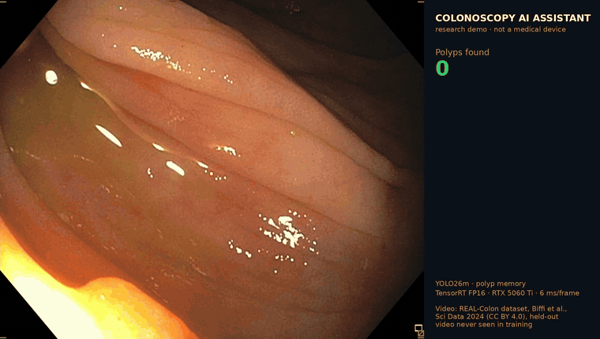
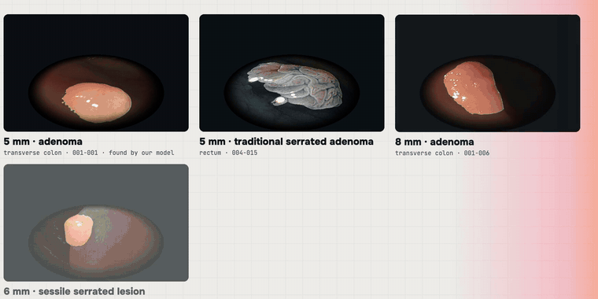

# Colonoscopy AI Assistant: real-time polyp detection with polyp memory

Research prototype by a physician turned ML engineer. **Not a medical device; not for clinical use.**



Endoscopists know the problem: a polyp appears, slips behind a fold, comes back, and over a long
procedure it is easy to lose track of it or count it twice. This project detects polyps in real time
and **remembers** them:

- **Detection:** YOLO26m (Ultralytics) trained on full colonoscopy videos from three clinics.
- **Stable alarms:** a polyp is announced only after ~0.8 s of steady detection, so single-frame
  flashes from glare, bubbles and folds never reach the screen.
- **Polyp memory:** when a polyp leaves the view, a dashed "ghost" stays where it was last seen with
  the time since; if it comes back it keeps its number instead of being counted again.
- **Fast and local:** TensorRT FP16, ~6 ms per frame on an RTX 5060 Ti. Video never leaves the machine.

## Results on colonoscopies never used for training

Clinician-level metrics, not just mAP. A polyp counts as *found* once a stable alarm overlaps it;
false alarms are alarm events on polyp-free frames. Operating point: score ≥ 0.45 and hits in 5 of
the last 8 processed frames (every 3rd frame).

| Video | Endoscope | Role | Polyps found | False alarms / min |
|---|---|---|---|---|
| 001-001 | Olympus | held-out (operating point chosen here) | 3 / 3 | 0.28 |
| 002-009 | Fujifilm, BLI light | validation | 5 / 5 | 0.36 |
| 003-002 | Olympus, 3rd clinic | validation | 4 / 4 | 0.30 |
| 002-010 | Olympus | **test, untouched** | 2 / 3 | 0.41 |
| 002-008 | Fujifilm | **test, untouched** | 2 / 3 | 1.14 |
| **Total** | | | **16 / 18** | **~0.5 mean** |

Every one of the 18 polyps was flagged at least briefly; the two misses in the untouched test videos
are faint lesions the model sees only intermittently. Next steps: hard-negative mining from the
false alarms and a temporal model.

## How it works

| Step | Script | Notes |
|---|---|---|
| Data | `scripts/realcolon_queue.sh`, `scripts/pget.py`, `scripts/download_hyperkvasir.sh` | Resumable, parallel range downloads (figshare is slow per connection) |
| Dataset | `medai_colon/prepare_yolo_v2.py` | Crop to the endoscope field of view per video; dense sampling while each polyp is first found, sparse during removal; split **by video** |
| Check | `medai_colon/show_labels.py` | Draws labels on samples; always look before training |
| Train | `medai_colon/train.py` | YOLO26m, 960 px, rotations/flips, small hue shift for BLI/NBI light; auto-resume |
| Evaluate | `medai_colon/eval_lesion.py`, `medai_colon/sweep.py` | Polyps found, time to detection, false alarms per minute; offline threshold/smoothing sweep |
| Demo | `medai_colon/render_demo.py` | Stable alarms, polyp memory, side panel |

```bash
uv venv --python 3.12 && uv pip install -r requirements.txt
scripts/realcolon_queue.sh 001-006 001-007 002-007 002-009 003-002 003-003 003-013 004-014 004-015
cd medai_colon
python prepare_yolo_v2.py --realcolon ../data/realcolon --train 001-006 001-007 002-007 003-003 003-013 004-014 004-015 --val 002-009 003-002 --out ../data/yolo_v2
cd .. && python medai_colon/train.py --data data/yolo_v2/data.yaml --name polyp_v2 --imgsz 960 --batch 8 --epochs 80
yolo export model=runs/detect/polyp_v2/weights/best.pt format=engine half=True imgsz=960
```

TensorRT 11 needs `nvidia-modelopt[onnx]` for the FP16 export.

## Polyps in 3D



A polyp's shape (pedunculated, sessile, flat) is part of how it is described and managed, but the
endoscope shows it in 2D. From one frame:

1. **Find:** our YOLO26m detector boxes the polyp.
2. **Cut out:** SAM 2 (Ultralytics), prompted with the box, gives a pixel mask.
3. **Depth:** Depth Anything V2 Small estimates relative depth of a crop around the polyp.
4. **Lift:** a plane is fitted to the mucosa around the polyp (robust least squares outside the
   mask); the elevation above it, in the same relative units for every polyp, becomes a 3D heightfield.

Size and histology shown with each polyp are the expert labels shipped with REAL-Colon.

| Step | Script | Notes |
|---|---|---|
| Views | `medai_colon/polyp_views.py` | Best frames per lesion: large, sharp, fully in view; contact sheet to choose by eye |
| 3D | `medai_colon/polyp3d.py` | Mask, depth, plane fit, elevation grids and labels; `--device cpu` when the GPU is busy |
| Video | `video/` (Remotion + Three.js) | `src/Polyp.tsx` heightfield shader; composition `Polyps3D` |

```bash
cd medai_colon
python polyp_views.py 001-001_2 004-015_3 001-006_4 003-013_2 004-014_3 003-003_4
python polyp3d.py 001-001_2:5 004-015_3:3 001-006_4:0 003-013_2:4 004-014_3:0 003-003_4:0
cp -r ../outputs/polyp3d/web ../video/public/polyp3d
cd ../video && npm install && npx remotion render src/index.ts Polyps3D out/polyps3d.mp4 --gl=angle
```

The same depth model can also lift a whole frame (`medai_colon/depth3d.py`, `export_web.py`,
composition `Colon3D`): z = 1 / (A + B·d) back-projected through an assumed 100° pinhole camera.

Limits: single-frame depth is **relative** (no millimetres) and the height scale is a choice, so the
3D shapes are a visualisation, not a measurement. SAM 2 and Depth Anything V2 Small are Apache-2.0
(the Depth Anything V2 Base/Large checkpoints are non-commercial).

## Data

- **REAL-Colon:** Biffi et al., *REAL-Colon: A dataset for developing real-world AI applications in
  colonoscopy*, Scientific Data 11, 539 (2024), CC BY 4.0. 60 full colonoscopies, polyp boxes on every frame.
- Depth: Yang et al., *Depth Anything V2*, NeurIPS 2024; Small checkpoint, Apache-2.0.
- Segmentation: Ravi et al., *SAM 2*, 2024 (Meta), Apache-2.0, via Ultralytics.
- HyperKvasir (Borgli et al., Scientific Data 2020, CC BY 4.0) is supported by the dataset builder.

No patient data is stored in this repository; scripts download the public datasets.

## Author

**Zalkarbek Arapbaev**, MD, AI Engineer, Bishkek ·
[LinkedIn](https://www.linkedin.com/in/zalkarbek-arapbaev-77185525a/) · [X](https://x.com/Zalkarbek_AI)

Code: [MIT License](LICENSE).
